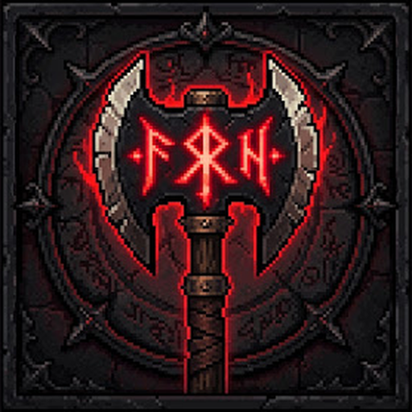

<p align="center">
  
</p>

# Echos Vrat — Echoes of the Ravaged: Wrath Edition

Game aksi 2D bertema dark fantasy yang ditulis dalam **satu file HTML** (canvas + JavaScript murni, tanpa library). Bisa dimainkan di browser, dibungkus jadi **APK Android** (WebView) dan **aplikasi Windows** (Electron).

> Proyek pertama, dibuat di Termux dengan bantuan AI. Laporan bug dan masukan sangat diterima lewat Issues.

## Cara main

| | |
|---|---|
| **PC** | `WASD` gerak · `J` serang ringan · `K` serang berat · `Q` parry · `Spasi` dodge · `E` mode amuk · `O` eksekusi · `U` skill · `C` ganti senjata · `T` lempar/panggil pedang · `V` panah roh · `Esc` jeda |
| **HP** | joystick di sisi kiri layar + tombol di layar (layar penuh, mode landscape) |

Serang berat berulang sampai kotak stun muncul di atas musuh, lalu tekan `O` untuk eksekusi. Parry yang tepat juga membuka kotak stun.

Musik baru berbunyi setelah ada sentuhan/klik pertama (aturan autoplay browser).

## Menjalankan di browser

Buka `game/index.html` di Chrome atau Firefox. Kalau musik tidak bunyi saat dibuka langsung dari file, jalankan server lokal:

```bash
cd game
python3 -m http.server 8000
# buka http://localhost:8000
```

## Struktur folder

```
echos-vrat/
├── game/
│   ├── index.html        # seluruh game (logika, grafis canvas, efek suara, UI)
│   └── music/            # 10 lagu MP3 (lihat Kredit)
├── android/
│   ├── build_apk.sh      # bikin APK langsung di Termux, tanpa Gradle
│   └── res/              # ikon aplikasi
├── windows/
│   ├── main.js           # pembungkus Electron
│   ├── package.json
│   ├── build_exe_termux.sh   # bikin paket Windows dari Termux
│   └── BUILD_EXE.bat         # bikin EchosVrat.exe di PC Windows
└── assets/               # logo dan cover itch.io
```

## Build APK (Termux)

1. Pasang Termux dari F-Droid, lalu jalankan sekali: `termux-setup-storage`
2. Dari folder utama repo:

```bash
bash android/build_apk.sh
```

Hasilnya `~/storage/downloads/EchosVrat.apk`. Script memasang `openjdk-17`, `aapt`, `ecj`, `dx`, `apksigner`, menulis manifest dan `MainActivity.java` (WebView layar penuh landscape), compile, dex, paket, lalu menandatangani APK dengan kunci `~/echos.jks` yang dibuat otomatis. **Jangan upload file `.jks` ke GitHub** (sudah diabaikan lewat `.gitignore`).

## Build Windows

**Dari Termux** (hasil: folder yang di-zip, jalankan `EchosVrat.exe` di dalamnya):

```bash
bash windows/build_exe_termux.sh
```

**Dari PC Windows** (hasil: satu file portable `dist\EchosVrat.exe`): pasang [Node.js](https://nodejs.org), lalu klik dua kali `windows/BUILD_EXE.bat`.

## Untuk yang mau review kode

Semuanya ada di `game/index.html`. Beberapa titik awal (cari nama fungsinya):

- `rs()` — penyesuaian ukuran layar: game punya resolusi logis tetap, lalu diskalakan dan diperluas ke seluruh layar tanpa bar hitam (memperhitungkan safe area/notch).
- `musWant()` / `musTick()` / `musGet()` — pemilih dan pemutar musik (crossfade antar lagu sesuai situasi). Efek suara dibuat dengan Web Audio, lagu diputar lewat `Audio`.
- `_bgOff()` / `_bgOn()` — menjeda game dan audio saat aplikasi masuk latar belakang.
- `startArea()`, `startFin()`, `esc()` — alur area/gelombang musuh, eksekusi (finisher), dan jeda.
- `DFS`, `ACH` — tingkat kesulitan dan daftar pencapaian.

## Kredit

Musik oleh **Kevin MacLeod** ([incompetech.com](https://incompetech.com)), dilisensikan di bawah [Creative Commons: By Attribution 4.0](https://creativecommons.org/licenses/by/4.0/).
Lagu dikonversi ke MP3 mono 24 kHz / 40 kbps agar ukuran file kecil.

| File | Judul | Dipakai untuk |
|---|---|---|
| `fog.mp3` | Dark Fog | menu dan layar awal |
| `chasm.mp3` | Crossing the Chasm | area biasa (genap) |
| `vol.mp3` | Volatile Reaction | area biasa (ganjil) |
| `words.mp3` | Ossuary 3 - Words | cutscene dan cerita |
| `turn.mp3` | Ossuary 2 - Turn | mini-boss |
| `vortex.mp3` | Black Vortex | boss |
| `killers.mp3` | Killers | boss terakhir |
| `resolve.mp3` | Ossuary 7 - Resolve | area 10 |
| `heart.mp3` | Heartbreaking | kalah dan akhir area |
| `air.mp3` | Ossuary 6 - Air | ending |

## Lisensi

Kode game belum diberi lisensi terbuka (semua hak dilindungi oleh pembuatnya). Musik tunduk pada lisensi CC BY 4.0 di atas.
